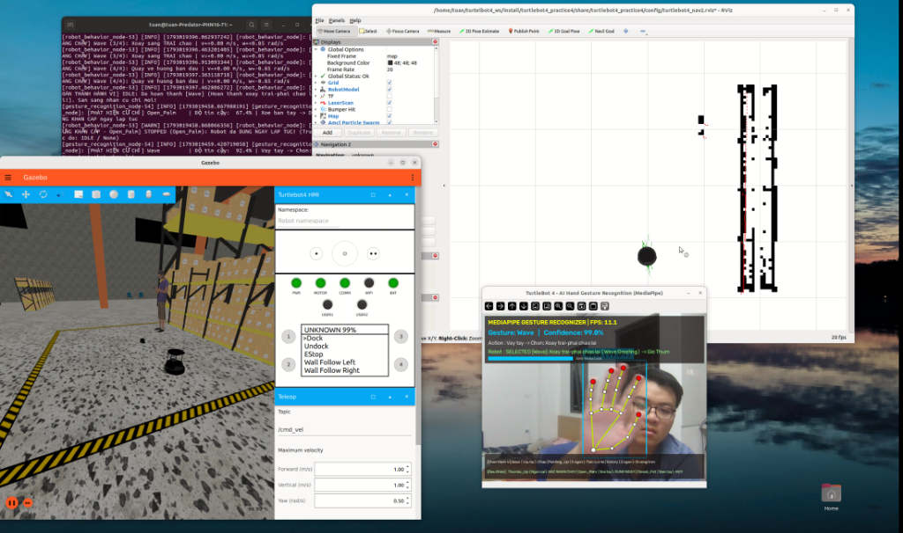

# BÁO CÁO KỸ THUẬT: BÀI TẬP 6
# GIAO TIẾP PHI NGÔN NGỮ VÀ ĐIỀU KHIỂN TURTLEBOT 4 BẰNG CỬ CHỈ TAY
## *(Non-verbal Human–Robot Interaction Using Hand Gesture Recognition)*

**Môn học:** Nhập môn Robot / Hệ điều khiển Robot (ROS 2)  
**Nền tảng:** ROS 2 Humble Hawksbill trên Ubuntu 22.04 LTS (Gazebo Fortress + RViz2)  
**Robot thực hiện:** TurtleBot 4 Standard (iRobot Create 3 Base + RPLiDAR 2D + Camera OAK-D)  
**Công nghệ AI nhận diện:** MediaPipe Gesture Recognizer (`gesture_recognizer.task` + 21 Hand Landmarks) & OpenCV  
**Sinh viên thực hiện:** Nguyễn Quang Tuân – MSSV: 23020767  
**Giảng viên hướng dẫn:** PGS.TS. Hoàng Văn Xiêm, CN. Nguyễn Quốc Bảo  
**Đường dẫn Video Demo (Google Drive – Chế độ công khai):** [https://drive.google.com/drive/folders/1vl4O0C9A4C3Ed_HwHmJAeVCzwEQZulCx?usp=drive_link](https://drive.google.com/drive/folders/1vl4O0C9A4C3Ed_HwHmJAeVCzwEQZulCx?usp=drive_link)  
**Đường dẫn GitHub Repository (Public):** [https://github.com/Tuan404cl/Turtlebot_sim_test3.git](https://github.com/Tuan404cl/Turtlebot_sim_test3.git)  

---

## I. SƠ ĐỒ KIẾN TRÚC HỆ THỐNG

Hệ thống được thiết kế theo kiến trúc phân tầng mô-đun hóa trên nền tảng **ROS 2 Humble**, kết nối trực tiếp từ tầng thị giác máy tính (Webcam Laptop + MediaPipe AI) tới tầng điều khiển hành vi (`robot_behavior_node`) và tầng mô phỏng vật lý (Gazebo Fortress + RViz2 Localization):

```
+---------------------------------------------------------------------------------------------------+
| TẦNG 1: THU NHẬN HÌNH ẢNH WEBCAM & NHẬN DIỆN CỬ CHỈ TAY BẰNG AI (gesture_recognition_node)        |
|  [Webcam Laptop /dev/video0] ---> [OpenCV BGR->RGB] ---> [MediaPipe Gesture Recognizer + 21 LMs]  |
|  ---> [Phân loại 06 cử chỉ + Dynamic Wave Detector] ---> [Bộ lọc chống nhiễu Temporal Debounce]   |
|  ---> [Hiển thị cửa sổ OpenCV: Khung xương tay, Tên cử chỉ, Độ tin cậy %, Trạng thái Robot]       |
+---------------------------------------------------------------------------------------------------+
                                                 |
                                                 | Publish: /detected_gesture (std_msgs/msg/String)
                                                 v
+---------------------------------------------------------------------------------------------------+
| TẦNG 2: ĐIỀU KHIỂN HÀNH VI & AN TOÀN ROBOT (robot_behavior_node)                                  |
|  +---------------------------------------------------------------------------------------------+  |
|  | Máy trạng thái hữu hạn (FSM):                                                               |  |
|  |   [1. IDLE (Chờ lệnh)] ---> Chọn (Wave / Pointing_Up / Victory) ---> [2. SELECTED]          |  |
|  |   [2. SELECTED]        ---> Xác nhận bằng Thumbs_Up             ---> [3. EXECUTING]         |  |
|  |   [3. EXECUTING]       ---> Open_Palm / Mất tín hiệu / Vật cản  ---> [4. STOPPED (Phanh)]   |  |
|  |   [Mọi trạng thái]     ---> Closed_Fist (Hủy hành vi)           ---> [1. IDLE (Chờ lệnh)]   |  |
|  +---------------------------------------------------------------------------------------------+  |
|  + Bộ lọc Edge-Trigger & Cooldown (1.2s)   + Watchdog mất tín hiệu (1.8s)   + Bảo vệ LiDAR /scan  |
+---------------------------------------------------------------------------------------------------+
                                                 |
                                                 | Publish: /cmd_vel (geometry_msgs/msg/Twist @ 20 Hz)
                                                 v
+---------------------------------------------------------------------------------------------------+
| TẦNG 3: MÔ PHỎNG GAZEBO FORTRESS, ĐỊNH VỊ BẢN ĐỒ AMCL & HIỂN THỊ TRỰC QUAN RVIZ2                  |
|  - Gazebo Fortress (world: warehouse): TurtleBot 4 Standard (safety_override='full' hỗ trợ lùi)   |
|  - Auto Undock & Open Space: Tự động rời trạm sạc và tiến 0.90m ra khu vực trung tâm rộng thoáng  |
|  - RViz2 + Map Server + AMCL: Nạp bản đồ map.yaml đã lưu, hiển thị RobotModel, /scan & quỹ đạo    |
+---------------------------------------------------------------------------------------------------+
```

---

## II. GIẢI THÍCH CÁC NODE, TOPIC VÀ LUỒNG XỬ LÝ

### 1. Giải thích các ROS 2 Node trong gói `turtlebot4_practice4`

1. **`webcam_cmdvel_check` (`webcam_cmdvel_check.py` – Phần 1):**
   * Kiểm tra kết nối các topic của TurtleBot 4 trong Gazebo (`/odom`, `/scan`, `/cmd_vel`).
   * Tự động cấu hình tham số `safety_override = 'full'` trên node `/motion_control` của đế Create 3 để mở khóa giới hạn lùi mặc định, giúp robot nhận được cả vận tốc tiến (`linear.x > 0`) và vận tốc lùi (`linear.x < 0`).
   * Phát lệnh vận tốc kiểm thử (tiến, lùi, xoay trái–phải, dừng) lên `/cmd_vel` và mở cửa sổ OpenCV đọc/hiển thị hình ảnh thời gian thực từ webcam laptop.

2. **`gesture_recognition_node` (`gesture_recognition_node.py` – Phần 2):**
   * Đọc khung hình thời gian thực từ webcam laptop (`/dev/video0`) bằng OpenCV (`640x480`), lật gương ngang để người dùng thuận tiện thao tác.
   * Sử dụng **MediaPipe Gesture Recognizer** (`config/gesture_recognizer.task`) trích xuất 21 điểm khớp bàn tay (*21 Hand Landmarks*) kết hợp thuật toán phát hiện dao động ngang cổ tay (`_detect_dynamic_wave`) để phân loại chính xác **06 cử chỉ tay**: `Wave`, `Pointing_Up`, `Victory`, `Thumbs_Up`, `Open_Palm`, `Closed_Fist`.
   * Lọc chống nhiễu qua cửa sổ trượt `debounce_frames = 4` khung hình với ngưỡng độ tin cậy `min_confidence = 0.58`.
   * Hiển thị trực quan khung xương bàn tay, hộp giới hạn (Bounding Box), tên cử chỉ, độ tin cậy (`Confidence %`), thanh khóa chống nhiễu (`Anti-Noise Lock`) và trạng thái hiện tại của robot lên cửa sổ OpenCV.
   * Publish kết quả nhận diện lên topic `/detected_gesture` (`std_msgs/msg/String`).

3. **`robot_behavior_node` (`robot_behavior_node.py` – Phần 3):**
   * Subscribe kết quả nhận diện từ topic `/detected_gesture` (`std_msgs/msg/String`), dữ liệu quét `/scan` (`LaserScan`) và `/odom` (`Odometry`).
   * Thực thi máy trạng thái hữu hạn (**FSM**) 4 trạng thái (`IDLE` $\rightarrow$ `SELECTED` $\rightarrow$ `EXECUTING` / `STOPPED`) và phát lệnh vận tốc lên topic `/cmd_vel` (`geometry_msgs/msg/Twist`) ở tần số `20 Hz`.
   * Publish trạng thái hiện tại lên topic `/robot_behavior_status` để đồng bộ hiển thị trực tiếp trên màn hình Webcam OpenCV.

4. **`auto_undock` (`auto_undock.py`) & Hệ thống Bản đồ RViz2 (`map_server`, `amcl`):**
   * Nạp bản đồ `maps/map.yaml` đã lưu từ các bài thực hành trước lên RViz2 và khởi chạy định vị AMCL.
   * Tự động gửi Action `/undock` đưa robot rời khỏi trạm sạc và di chuyển tiến thêm `0.90m` ra vùng không gian mở trung tâm, đảm bảo khu vực thực hiện các hành vi đủ rộng và hoàn toàn không va chạm.

### 2. Bảng tổng hợp các ROS 2 Topic cốt lõi

| Tên Topic | Kiểu Message | Tần số | Luồng dữ liệu và vai trò trong hệ thống |
| :--- | :--- | :--- | :--- |
| `/detected_gesture` | `std_msgs/msg/String` | 15 Hz | **Topic chính (Phần 2 $\rightarrow$ Phần 3):** Truyền nhãn cử chỉ tay đã lọc chống nhiễu (`Wave`, `Pointing_Up`, `Victory`, `Thumbs_Up`, `Open_Palm`, `Closed_Fist`, `None`). |
| `/cmd_vel` | `geometry_msgs/msg/Twist` | 20 Hz | **Topic điều khiển vận tốc:** Truyền vận tốc dài `linear.x` ($v$) và vận tốc góc `angular.z` ($\omega$) từ `robot_behavior_node` xuống TurtleBot 4. |
| `/robot_behavior_status` | `std_msgs/msg/String` | Khi đổi / 2.5 Hz | Truyền trạng thái FSM của robot ngược về `gesture_recognition_node` để hiển thị trực tiếp trên cửa sổ Webcam. |
| `/scan` | `sensor_msgs/msg/LaserScan` | 10 Hz | Dữ liệu quét LiDAR $360^\circ$ dùng cho định vị AMCL trên RViz2 và bảo vệ chống va chạm ($< 0.25\text{ m}$) trong `robot_behavior_node`. |
| `/odom` | `nav_msgs/msg/Odometry` | 20–62 Hz | Phản hồi vị trí $(x, y)$ và góc hướng `yaw` thực tế của robot trong Gazebo. |
| `/map` | `nav_msgs/msg/OccupancyGrid` | Transient Local | Bản đồ 2D (`map.yaml` & `map.pgm`) hiển thị trên giao diện RViz2. |

---

## III. BẢNG ÁNH XẠ CỬ CHỈ TAY VÀ HÀNH VI ROBOT

Hệ thống nhận diện và điều khiển đầy đủ **06 cử chỉ tay** (vượt yêu cầu tối thiểu 05 cử chỉ của đề bài):

| STT | Cử chỉ tay | Nhãn trên `/detected_gesture` | Cơ chế nhận diện AI (MediaPipe + 21 Landmarks) | Hành vi của TurtleBot 4 & Thông số điều khiển `/cmd_vel` |
| :---: | :--- | :--- | :--- | :--- |
| **1** | **Vẫy tay** *(Wave)* | `Wave` | Bàn tay mở ($\ge 3$ ngón duỗi) kết hợp dao động lắc ngang cổ tay ($\Delta x \ge 0.055$, quãng đường ngang $\ge 0.115$ trong $0.85\text{ s}$) hoặc cử chỉ `ILoveYou`. | **Chọn hành vi: Robot xoay trái–phải để chào lại.** Khi xác nhận bằng `Thumbs_Up`: thực hiện 4 pha xoay đối xứng ($\omega = \pm 0.85\text{ rad/s}$) giúp robot lắc chào 2 nhịp trái–phải và quay về đúng góc ban đầu. |
| **2** | **Giơ 1 ngón tay** *(Pointing Up)* | `Pointing_Up` | MediaPipe phân loại `Pointing_Up` (kết hợp kiểm tra hình học chỉ duy nhất ngón trỏ số 8 duỗi thẳng). | **Chọn hành vi: Tiến–lùi 4 lần.** Khi xác nhận bằng `Thumbs_Up`: thực hiện đúng 4 chu kỳ liên tiếp, mỗi chu kỳ tiến thẳng ($v = +0.20\text{ m/s}$ trong $1.8\text{ s}$), nghỉ $0.35\text{ s}$, lùi về ($v = -0.20\text{ m/s}$ trong $1.8\text{ s}$), nghỉ $0.35\text{ s}$. |
| **3** | **Giơ 2 ngón tay** *(Victory)* | `Victory` | MediaPipe phân loại `Victory` (2 ngón trỏ và giữa duỗi chữ V, các ngón còn lại gập). | **Chọn hành vi: Di chuyển theo quỹ đạo tròn.** Khi xác nhận bằng `Thumbs_Up`: phát đồng thời $v = 0.18\text{ m/s}$ và $\omega = 0.45\text{ rad/s}$ tạo quỹ đạo tròn bán kính $R = \frac{v}{\omega} = 0.40\text{ m}$ khép kín $360^\circ$ ($T \approx 14.0\text{ s}$). |
| **4** | **Giơ ngón cái** *(Thumbs Up)* | `Thumbs_Up` | MediaPipe phân loại `Thumb_Up` với độ tin cậy $\ge 58\%$. | **Xác nhận và thực hiện hành vi đã chọn:** Chuyển trạng thái FSM từ `SELECTED` sang `EXECUTING` để bắt đầu thực thi hành vi đã chọn. |
| **5** | **Xòe bàn tay** *(Open Palm)* | `Open_Palm` | MediaPipe phân loại `Open_Palm` khi bàn tay xòe giữ tĩnh (không lắc ngang). | **Robot dừng ngay lập tức (*Emergency Stop*):** Phát ngay tức khắc `Twist(0.0, 0.0)` lên `/cmd_vel`, dừng mọi chuyển động và chuyển sang trạng thái `STOPPED`. |
| **6** | **Nắm tay** *(Closed Fist)* | `Closed_Fist` | MediaPipe phân loại `Closed_Fist` (5 ngón tay nắm kín). | **Hủy hành vi hiện tại và trở về trạng thái chờ (`IDLE`):** Hủy bỏ hành vi đang chạy hoặc đang chọn, dừng robot (`Twist(0.0, 0.0)`) và đưa FSM về `IDLE`. |

### Đáp ứng đầy đủ các yêu cầu kỹ thuật của bài tập:
* **Chỉ thực hiện hành vi sau khi nhận được cử chỉ xác nhận (`Thumbs_Up`):** Các cử chỉ `Wave`, `Pointing_Up`, `Victory` chỉ đưa robot vào trạng thái chờ xác nhận (`SELECTED`, vận tốc bằng `0`). Chỉ khi nhận được `Thumbs_Up`, robot mới chuyển sang `EXECUTING`.
* **Hoàn toàn không sử dụng bàn phím trong quá trình demo:** Từ bước Undock rời trạm sạc ra vùng rộng đến việc chọn, xác nhận, dừng khẩn cấp và hủy hành vi đều thực hiện 100% tự động và qua cử chỉ tay trước webcam.
* **Cơ chế chống nhận diện nhiễu kích hoạt liên tục:** Kết hợp bộ lọc đa số 4 khung hình (`Temporal Debounce`) tại node nhận diện cùng cơ chế `Edge-Trigger` và `command_cooldown = 1.2s` tại node điều khiển.
* **Dừng ngay khi nhận tín hiệu dừng hoặc mất tín hiệu điều khiển:** Cử chỉ `Open_Palm` được ưu tiên xử lý tức thời; đồng thời bộ giám sát **Watchdog Timer** (`signal_timeout = 1.8s`) tự động phanh dừng robot nếu mất luồng bản tin `/detected_gesture`.
* **Khu vực mô phỏng đủ rộng, không va chạm:** Robot tự động tiến ra khoảng sân trống rộng rãi sau khi Undock và luôn có lớp bảo vệ khoảng cách tối thiểu `0.25m` từ cảm biến LiDAR `/scan`.

---

## IV. HÌNH ẢNH MINH HỌA KẾT QUẢ THỰC NGHIỆM



*Hình 1: Toàn cảnh hệ thống hoạt động thực tế gồm 4 cửa sổ: (1) Góc dưới phải: Cửa sổ Webcam AI MediaPipe nhận diện cử chỉ `Wave` với độ tin cậy `99.0%` và hiển thị trạng thái `SELECTED [Wave] -> Gio Thumbs_Up de XAC NHAN!`; (2) Góc dưới trái: Gazebo Fortress với TurtleBot 4 ở khu vực sàn rộng rãi không vật cản; (3) Góc trên phải: RViz2 hiển thị bản đồ `map.yaml` đã lưu, tia quét LiDAR `/scan` và đám hạt AMCL; (4) Góc trên trái: Terminal log ghi nhận quá trình thực thi hành vi xoay chào, dừng khẩn cấp `Open_Palm` và chọn hành vi mới.*

---

## V. HƯỚNG DẪN CÀI ĐẶT, BUILD VÀ CHẠY CHƯƠNG TRÌNH

```bash
# 1. Biên dịch workspace
cd /home/tuan/turtelbot4_ws
source /opt/ros/humble/setup.bash
colcon build --symlink-install --packages-select turtlebot4_practice4
source install/setup.bash

# 2. Chạy tích hợp toàn bộ (Gazebo + Bản đồ RViz2 + Auto Undock + Gesture Node + Behavior Node):
./src/turtlebot4_practice4/scripts/run_gesture_all.sh

# 3. Hoặc chạy riêng từng phần:
# Phần 1 – Kiểm tra /cmd_vel và đọc/hiển thị Webcam bằng OpenCV:
./src/turtlebot4_practice4/scripts/run_gesture_part1_sim_webcam.sh

# Phần 2 – Nhận diện cử chỉ tay bằng AI (gesture_recognition_node):
./src/turtlebot4_practice4/scripts/run_gesture_part2_recognition.sh

# Phần 3 – Điều khiển hành vi TurtleBot 4 (robot_behavior_node):
./src/turtlebot4_practice4/scripts/run_gesture_part3_behavior.sh
```
