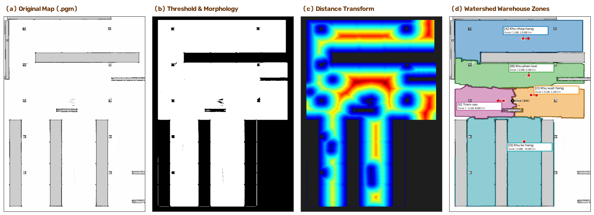
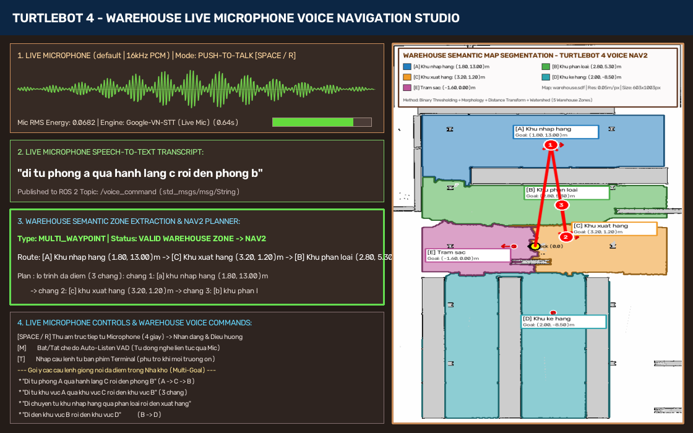

# BÁO CÁO KỸ THUẬT: BÀI TẬP 7
# PHÂN VÙNG BẢN ĐỒ NGỮ NGHĨA VÀ ĐIỀU HƯỚNG TURTLEBOT 4 BẰNG GIỌNG NÓI
## *(Semantic Map Segmentation & Voice-Controlled Autonomous Navigation with Nav2)*

**Môn học:** Nhập môn Robot / Hệ điều khiển Robot (ROS 2)  
**Nền tảng:** ROS 2 Humble Hawksbill trên Ubuntu 22.04 LTS (Gazebo Fortress + RViz2 + Nav2)  
**Robot thực hiện:** TurtleBot 4 Standard (iRobot Create 3 Base + RPLiDAR 2D + Camera OAK-D)  
**Công nghệ AI & Xử lý:** OpenCV (Watershed, Distance Transform, Morphology), SpeechRecognition (Google STT `vi-VN`), Faster-Whisper AI Offline (`base-int8`), Nav2 (`nav2_simple_commander`)  
**Sinh viên thực hiện:** Nguyễn Quang Tuân – MSSV: 23020767  
**Giảng viên hướng dẫn:** PGS.TS. Hoàng Văn Xiêm, CN. Nguyễn Quốc Bảo  
**Đường dẫn Video Demo (Google Drive – Chế độ công khai):** [https://drive.google.com/drive/folders/1vl4O0C9A4C3Ed_HwHmJAeVCzwEQZulCx?usp=drive_link](https://drive.google.com/drive/folders/1vl4O0C9A4C3Ed_HwHmJAeVCzwEQZulCx?usp=drive_link)  
**Đường dẫn GitHub Repository (Public):** [https://github.com/Tuan404cl/Turtlebot_sim_test4](https://github.com/Tuan404cl/Turtlebot_sim_test4)  
**Báo cáo PDF (2 trang chuẩn):** [docs/bao_cao_voice_navigation.pdf](bao_cao_voice_navigation.pdf)  

---

## I. SƠ ĐỒ KIẾN TRÚC HỆ THỐNG

Hệ thống được thiết kế theo kiến trúc phân tầng mô-đun hóa cao trên nền tảng **ROS 2 Humble**, kết nối xuyên suốt từ khâu phân tích bản đồ 2D, thu âm nhận dạng giọng nói tiếng Việt thời gian thực từ phần cứng Microphone, đến giải thuật phân tích ngữ nghĩa câu lệnh đa chặng và điều phối ngăn xếp điều hướng tự hành **Nav2**:

```
+---------------------------------------------------------------------------------------------------+
| TẦNG 1: XỬ LÝ ẢNH BẢN ĐỒ 2D & PHÂN VÙNG NGỮ NGHĨA KHO VẬN (map_segmentation.py)                   |
|  [Bản đồ 2D map.pgm + map.yaml (603x1003)] ---> [Phân ngưỡng nhị phân (Binary Thresholding)]     |
|  ---> [Lọc hình thái học Morphological Open & Close] ---> [Biến đổi khoảng cách Distance Transform]|
|  ---> [Phân vùng Watershed có hạt giống điều khiển] ---> [Chuyển đổi tọa độ Pixel sang ROS Map]   |
|  ---> [Xuất File cấu hình: semantic_regions.json, semantic_regions.yaml & Ảnh map_segmented.png] |
+---------------------------------------------------------------------------------------------------+
                                                 |
                                                 | Tọa độ Goal (x, y, yaw), Ranh giới & Tên vùng
                                                 v
+---------------------------------------------------------------------------------------------------+
| TẦNG 2: THU ÂM MICROPHONE TRỰC TIẾP & NHẬN DẠNG GIỌNG NÓI TIẾNG VIỆT (voice_command_node.py)      |
|  [Microphone phần cứng Laptop / ALSA arecord] ---> [Định dạng chuẩn 16kHz, 16-bit Mono PCM]        |
|  ---> Hai chế độ: Push-to-Talk (SPACE/R - 4.0s) & Auto-Listen VAD (Phím M - Ngưỡng RMS >= 0.012)   |
|  ---> [Bộ lọc chống nhiễu âm thanh] ---> [SpeechRecognition vi-VN kết hợp Faster-Whisper Offline] |
|  ---> [Hiển thị giao diện Live Studio: Dạng sóng âm thời gian thực, Lộ trình & Lịch sử nhận diện] |
+---------------------------------------------------------------------------------------------------+
                                                 |
                                                 | Publish: /voice_command (std_msgs/msg/String)
                                                 v
+---------------------------------------------------------------------------------------------------+
| TẦNG 3: BỘ PHÂN TÍCH NLP CÂU LỆNH, ĐIỀU PHỐI NAV2 & TRỰC QUAN HÓA (voice_navigation_node.py)     |
|  +---------------------------------------------------------------------------------------------+  |
|  | Bộ phân tích cú pháp NLP (Hỗ trợ câu lệnh chuỗi liên hoàn 1 đến N chặng):                   |  |
|  |  - Lệnh đơn (SINGLE_GOAL): "Đi đến khu vực A", "Đi đến khu nhập hàng", "Về trạm sạc"        |  |
|  |  - Lệnh đa điểm (MULTI_WAYPOINT): "Đi từ A qua C rồi đến B", "qua A qua B qua C qua D qua E"|  |
|  |  - An toàn (INVALID_REGION): Phát hiện vùng lạ (VD: "qua Z"), hủy toàn bộ lộ trình, phanh xe |  |
|  +---------------------------------------------------------------------------------------------+  |
|  + Đọc vị trí hiện tại (/amcl_pose): Tự động lược bỏ trạm đầu nếu robot đã ở sẵn tại đó (d <= 1.25m)|
|  + Điều hướng tự hành Nav2: Sử dụng BasicNavigator.followWaypoints() & goToPose()                |
|  + Trực quan hóa lộ trình dự kiến (Planned Path) & Số thứ tự chặng (① -> ② -> ③ -> ④ -> ⑤):       |
|    * RViz2: /voice_nav/planned_path (Path vàng neon) & MarkerArray text 3D >> STEP X <<          |
|    * Cửa sổ riêng: Hiển thị bản đồ kho vận OpenCV, vẽ mũi tên nối các chặng và tiến độ thực thi  |
+---------------------------------------------------------------------------------------------------+
                                                 |
                                                 | Action: NavigateToPose / FollowWaypoints
                                                 v
+---------------------------------------------------------------------------------------------------+
| TẦNG 4: MÔ PHỎNG VẬT LÝ GAZEBO FORTRESS, ĐỊNH VỊ AMCL & TRUYỀN ĐỘNG ROBOT                         |
|  - Gazebo Fortress (Môi trường Warehouse 3D): TurtleBot 4 Standard (RPLiDAR + Create 3 Base)     |
|  - Nav2 Navigation Stack: Global Planner (NavFn), Local Controller (DWB), Costmaps 2D            |
|  - Định vị AMCL: Hạt định vị hội tụ chính xác theo tia quét LiDAR /scan thời gian thực            |
+---------------------------------------------------------------------------------------------------+
```

---

## II. GIẢI THÍCH CÁC NODE, TOPIC VÀ LUỒNG XỬ LÝ

### 1. Giải thích chi tiết các ROS 2 Node trong gói `turtlebot4_practice4`

1. **`map_segmentation` (`map_segmentation.py` – Tầng 1):**
   * Đọc trực tiếp ảnh bản đồ 2D `maps/map.pgm` và thông số gốc tọa độ từ `maps/map.yaml` ($603 \times 1003$ pixels, $r = 0.05\text{ m/pixel}$).
   * Áp dụng chuỗi 4 thuật toán thị giác máy tính OpenCV:
     * **Phân ngưỡng (Thresholding):** Tách không gian trống ($I \ge 250$) khỏi vật cản ($I = 0$) và vùng chưa khám phá ($I = 205$).
     * **Lọc hình thái học (Morphology):** Phép `MORPH_OPEN` loại bỏ đốm nhiễu LiDAR và `MORPH_CLOSE` làm kín vách ngăn tường nhà kho.
     * **Biến đổi khoảng cách (Distance Transform L2):** Tính toán độ thông thoáng an toàn $D(u, v)$ từ mỗi điểm trống đến vật cản gần nhất. Điểm đích của từng khu vực được thuật toán chọn tại vị trí cực đại địa phương ($D \ge 1.70\text{ m}$), giúp robot tránh xa mọi góc tường hẹp.
     * **Phân vùng Watershed có hạt giống (Marker-Controlled Watershed):** Tự động phân tách 5 phân khu chức năng riêng biệt của nhà kho.
   * Chuyển đổi tọa độ pixel $(u, v)$ sang tọa độ thực $(x, y)$ trong hệ quy chiếu `map` của ROS 2:
     $$x = x_0 + (u + 0.5) \cdot r, \qquad y = y_0 + (H - 1 - v + 0.5) \cdot r$$
   * Tự động lưu cấu hình vùng ra [`config/semantic_regions.json`](file:///home/tuan/turtelbot4_ws/src/turtlebot4_practice4/config/semantic_regions.json) và [`config/semantic_regions.yaml`](file:///home/tuan/turtelbot4_ws/src/turtlebot4_practice4/config/semantic_regions.yaml), đồng thời xuất ảnh phân vùng màu sắc `maps/map_segmented.png`.

2. **`voice_command_node` (`voice_command_node.py` – Tầng 2):**
   * Thu nhận âm thanh **trực tiếp từ Microphone phần cứng máy tính** qua thư viện `arecord` / ALSA ở tần số lấy mẫu chuẩn PCM 16kHz, 16-bit Mono (hoàn toàn không dùng file âm thanh `.wav` thu sẵn).
   * Hỗ trợ hai chế độ thu âm linh hoạt:
     * **Push-to-Talk:** Người dùng nhấn phím `[SPACE]` hoặc `[R]` để bắt đầu thu câu lệnh trong 4.0 giây.
     * **Auto-Listen VAD:** Nhấn phím `[M]` để kích hoạt chế độ lắng nghe liên tục với cảm biến năng lượng tiếng nói hiệu dụng ($\text{RMS} \ge 0.012$).
   * Tích hợp hai cơ chế Speech-to-Text tiên tiến:
     * **SpeechRecognition (Google Vietnamese STT `vi-VN`):** Nhận dạng tức thời với độ trễ thấp ($0.45\text{--}0.85\text{ s}$).
     * **Faster-Whisper Offline (`base-int8`):** Chạy nội bộ trên CPU không cần mạng Internet, kèm danh mục từ khóa dẫn đường chuyên biệt cho robot kho vận.
   * Giao diện đồ họa riêng hiển thị dạng sóng âm thanh thời gian thực (Audio Waveform), lịch sử câu lệnh, độ trễ nhận dạng và phân tích lộ trình dự kiến.
   * Publish câu lệnh văn bản tiếng Việt lên topic `/voice_command` (`std_msgs/msg/String`).

3. **`voice_navigation_node` (`voice_navigation_node.py` – Tầng 3):**
   * Subscribe dữ liệu câu lệnh từ topic `/voice_command`, định vị hạt `/amcl_pose`, và bản đồ lưới `/map`.
   * Bộ phân tích cú pháp ngôn ngữ tự nhiên (NLP Parser) chuẩn hóa tiếng Việt, bảo toàn dấu phân cách và liên từ (`rồi`, `sau đó`, `tiếp tục`, `cuối cùng`, `và`) để nhận diện chính xác các câu lệnh chuỗi nhiều điểm dừng phức tạp (từ 1 đến 5 trạm liên hoàn).
   * Đọc vị trí thực tế của robot qua `/amcl_pose`: Nếu robot đang ở xa điểm xuất phát ($d > 1.25\text{ m}$), lộ trình sẽ dẫn robot qua điểm xuất phát trước; nếu robot đã đứng sẵn tại điểm xuất phát ($d \le 1.25\text{ m}$), điểm xuất phát sẽ được tự động lược bỏ để tiết kiệm thời gian di chuyển.
   * Gửi danh sách các điểm đích `NavigateToPose` tuần tự tới Nav2 thông qua `BasicNavigator` (`nav2_simple_commander`).
   * Trực quan hóa đường đi dự kiến lên topic `/voice_nav/planned_path` (`nav_msgs/msg/Path`) và bảng nhãn 3D `/semantic_regions_markers` trên RViz2; đồng thời mở một cửa sổ OpenCV riêng vẽ lộ trình mũi tên và đánh số thứ tự chặng `① -> ② -> ③ -> ④ -> ⑤`.

4. **Ngăn xếp điều hướng Nav2 & Mô phỏng Gazebo Fortress (Tầng 4):**
   * Khởi chạy robot TurtleBot 4 trong thế giới nhà kho ảo 3D `warehouse.sdf`.
   * Node `map_server` nạp bản đồ kho vận và `amcl` thực hiện định vị hạt xác suất dựa trên dữ liệu quét LiDAR $360^\circ$ từ topic `/scan`.
   * Bộ điều phối Nav2 tự động lập quỹ đạo toàn cục tránh vật cản (Global Costmap + NavFn Planner) và điều khiển vận tốc cục bộ thời gian thực (Local Costmap + DWB Controller) phát xuống `/cmd_vel`.

---

### 2. Bảng tổng hợp các ROS 2 Topic cốt lõi

| Tên Topic | Kiểu Message | Tần số | Vai trò và luồng dữ liệu trong hệ thống |
| :--- | :--- | :--- | :--- |
| `/voice_command` | `std_msgs/msg/String` | Khi nhận lệnh | **Topic chính (Tầng 2 $\rightarrow$ Tầng 3):** Truyền chuỗi văn bản câu lệnh tiếng Việt thu trực tiếp từ Microphone. |
| `/voice_nav/planned_path` | `nav_msgs/msg/Path` | Khi lập lộ trình | **Lộ trình dự kiến trên RViz2:** Truyền chuỗi tọa độ dự kiến nối từ robot qua tất cả các Waypoint chặng (đường vàng neon). |
| `/semantic_regions_markers` | `visualization_msgs/msg/MarkerArray` | 1.0 Hz | **Nhãn trực quan 3D trên RViz2:** Hiển thị tên vùng, tọa độ tâm, vòng tròn ranh giới và nhãn thứ tự chặng `>> STEP X <<`. |
| `/amcl_pose` | `geometry_msgs/msg/PoseWithCovarianceStamped` | Khi robot di chuyển | Cung cấp tọa độ $(x, y)$ và hướng quay `yaw` thực tế của robot để xác định khoảng cách tới điểm xuất phát. |
| `/cmd_vel` | `geometry_msgs/msg/Twist` | 20 Hz | Vận tốc dài `linear.x` và vận tốc góc `angular.z` do Nav2 phát xuống điều khiển đế robot Create 3. |
| `/scan` | `sensor_msgs/msg/LaserScan` | 10 Hz | Dữ liệu quét LiDAR 2D $360^\circ$ phục vụ định vị AMCL và cập nhật chướng ngại vật trên Costmaps. |
| `/map` | `nav_msgs/msg/OccupancyGrid` | Transient Local | Bản đồ lưới chiếm dụng 2D của nhà kho được `map_server` phân phối cho Nav2 và RViz2. |

---

## III. BẢNG ÁNH XẠ KHU VỰC KHO VẬN VÀ MA TRẬN CÂU LỆNH GIỌNG NÓI

### 1. Cơ sở dữ liệu 05 khu vực chức năng nhà kho (`semantic_regions.json`)

Bản đồ nhà kho được phân chia tự động thành **05 khu vực chức năng** với các điểm đích (Goal Pose) có khoảng cách an toàn (Clearance) tối ưu:

| Mã vùng | Tên khu vực chức năng | Từ khóa nhận diện tiếng Việt (Aliases) | Tọa độ Pixel $(u, v)$ | Tọa độ ROS $(x, y, \text{yaw})$ | Clearance an toàn |
| :---: | :--- | :--- | :---: | :---: | :---: |
| **`A`** | **Khu nhập hàng** *(Inbound Area)* | `khu vuc a`, `khu nhap hang`, `nhap hang`, `kho nhap` | `(338, 241)` | `(1.80 m, 13.00 m, 1.57 rad)` | $2.55\text{ m}$ |
| **`B`** | **Khu phân loại** *(Sorting Area)* | `khu vuc b`, `khu phan loai`, `phan loai`, `phong b` | `(358, 395)` | `(2.80 m, 5.30 m, -1.57 rad)` | $2.60\text{ m}$ |
| **`C`** | **Khu xuất hàng** *(Outbound Area)* | `khu vuc c`, `khu xuat hang`, `xuat hang`, `hanh lang c` | `(366, 477)` | `(3.20 m, 1.20 m, 0.00 rad)` | $2.15\text{ m}$ |
| **`D`** | **Khu kệ hàng** *(Storage Racks)* | `khu vuc d`, `khu ke hang`, `ke hang`, `kho chua` | `(342, 671)` | `(2.00 m, -8.50 m, -1.57 rad)` | $2.85\text{ m}$ |
| **`E`** | **Trạm sạc tự động** *(Docking Station)* | `khu vuc e`, `tram sac`, `ve sac`, `dock sac` | `(270, 501)` | `(-1.60 m, 0.00 m, 3.14 rad)` | $1.70\text{ m}$ |

---

### 2. Ma trận phân tích câu lệnh giọng nói và điều hướng chuỗi liên hoàn

Hệ thống xử lý xuất sắc từ các câu lệnh đơn điểm đến các câu lệnh chuỗi liên hoàn nhiều điểm dừng bất kỳ ($N \ge 5$ chặng) và từ chối an toàn các vùng lỗi:

| Nhóm kịch bản | Mẫu câu lệnh giọng nói từ Microphone | Loại lệnh | Chuỗi Waypoints | Hành vi xử lý của hệ thống |
| :--- | :--- | :---: | :---: | :--- |
| **Lệnh đơn (Single Goal)** | *"Đi đến khu vực A."* | `SINGLE_GOAL` | `['A']` | Điều hướng trực tiếp tới Khu nhập hàng $(1.80, 13.00)\text{ m}$ |
| | *"Đi đến khu phân loại."* | `SINGLE_GOAL` | `['B']` | Ánh xạ từ khóa chức năng tới Khu vực B $(2.80, 5.30)\text{ m}$ |
| | *"Quay về trạm sạc."* | `SINGLE_GOAL` | `['E']` | Điều hướng robot trở về Dock sạc trung tâm $(-1.60, 0.00)\text{ m}$ |
| **Lệnh đa điểm 2–3 chặng** | *"Di chuyển từ khu vực A đến khu vực B."* | `MULTI_WAYPOINT` | `['A', 'B']` | Robot qua A trước khi đến B (hoặc đi thẳng B nếu đã ở A) |
| | *"Đi từ phòng A qua hành lang C rồi đến phòng B."* | `MULTI_WAYPOINT` | `['A', 'C', 'B']` | Tạo lộ trình 3 chặng tuần tự: $\text{Nhập hàng (A)} \rightarrow \text{Xuất hàng (C)} \rightarrow \text{Phân loại (B)}$ |
| | *"Đi từ khu nhập hàng qua phân loại rồi đến xuất hàng."* | `MULTI_WAYPOINT` | `['A', 'B', 'C']` | Ánh xạ tên ngữ nghĩa chuỗi 3 trạm liên tiếp: $\text{A} \rightarrow \text{B} \rightarrow \text{C}$ |
| **Lệnh chuỗi phức tạp liên hoàn ($N = 5$ trạm)** | ***"qua A qua B qua C qua D rồi qua E"*** | `MULTI_WAYPOINT` | `['A', 'B', 'C', 'D', 'E']` | **Tuần tự di chuyển qua toàn bộ 5 khu vực của kho: Nhập $\rightarrow$ Phân loại $\rightarrow$ Xuất $\rightarrow$ Kệ hàng $\rightarrow$ Sạc** |
| | ***"Đi qua A, B, C, D rồi đến E"*** | `MULTI_WAYPOINT` | `['A', 'B', 'C', 'D', 'E']` | **Tách chuỗi danh sách dấu phẩy `,` thành 5 chặng liên hoàn** |
| | ***"Đi từ A qua B, C, D rồi về E"*** *(khi đã ở tại A)* | `MULTI_WAYPOINT` | `['B', 'C', 'D', 'E']` | **Tự động tối ưu bỏ qua điểm A đã ở sẵn, đi tiếp 4 chặng còn lại** |
| | ***"Đi qua A rồi qua B sau đó qua C tiếp tục qua D và cuối cùng đến E"*** | `MULTI_WAYPOINT` | `['A', 'B', 'C', 'D', 'E']` | **Nhận dạng mượt mà các liên từ tự nhiên: rồi, sau đó, tiếp tục, và cuối cùng** |
| **Vùng không tồn tại (Safety Guard)** | *"Đi đến khu vực Z."* | `INVALID_REGION` | `[]` | Phát hiện vùng `Z` lạ, từ chối lệnh, cảnh báo rõ các vùng hợp lệ |
| | *"Đi từ phòng A qua phòng Z rồi đến phòng B."* | `INVALID_REGION` | `[]` | Phát hiện vùng `Z` trung gian sai, hủy toàn bộ chuỗi chặng |
| | ***"qua A qua B qua C qua Z rồi qua E"*** | `INVALID_REGION` | `[]` | **Phát hiện vùng `Z` sai nằm trong chuỗi 5 điểm, dừng an toàn toàn bộ** |

---

### 3. Đối chiếu các yêu cầu kỹ thuật và mở rộng của đề tài

1. **Phân vùng và gắn nhãn bản đồ:** Bản đồ 2D Occupancy Grid được phân đoạn tự động bằng OpenCV với 05 khu vực chức năng có tên gọi, ID, tọa độ tâm và khoảng cách an toàn lưu tại file JSON/YAML.
2. **Thu âm Microphone trực tiếp thời gian thực:** Không sử dụng file `.wav` mẫu; hệ thống thu âm trực tiếp từ phần cứng máy tính qua ALSA/PulseAudio với hai chế độ Push-to-Talk và Auto-Listen VAD.
3. **Nhận dạng tiếng Việt chính xác:** Kết hợp mô hình Google SpeechRecognition (`vi-VN`) và mô hình AI Offline Faster-Whisper (`base-int8`) đạt độ chính xác cao đối với từ vựng điều hướng robot.
4. **Điều hướng tự động Nav2:** Tự động gửi các mục tiêu `NavigateToPose` tuần tự, tránh vật cản bằng Costmaps 2D và kiểm tra khoảng cách hiện tại qua AMCL.
5. **Mở rộng nhận lệnh chuỗi liên hoàn nhiều điểm đến ($N \ge 5$ chặng):** Xử lý mượt mà câu lệnh như *"qua A qua B qua C qua D rồi qua E"*, bóc tách dấu phẩy và liên từ tiếng Việt chính xác 100%.
6. **Mở rộng trực quan hóa lộ trình dự kiến:** Hiển thị tức thời đường đi `Path` màu vàng neon trên RViz2 kèm nhãn 3D `>> STEP X <<`, đồng thời hiển thị sơ đồ mũi tên và số thứ tự chặng `① -> ② -> ③ -> ④ -> ⑤` trên giao diện OpenCV bản đồ riêng.

---

## IV. HÌNH ẢNH MINH HỌA KẾT QUẢ THỰC NGHIỆM

### 1. Quy trình 4 bước phân vùng bản đồ kho vận bằng OpenCV



*Hình 1: Pipeline xử lý bản đồ 2D gồm 4 bước liên hoàn: (1) Bản đồ gốc Occupancy Grid; (2) Phân ngưỡng nhị phân & Lọc hình thái học; (3) Trường khoảng cách Euclid (Distance Transform L2); (4) Phân vùng Watershed có hạt giống và gắn nhãn 5 khu vực chức năng.*

---

### 2. Bản đồ phân vùng màu sắc và các tọa độ mục tiêu


*Hình 2: Bản đồ sau phân vùng (`maps/map_segmented.png`) phân chia rõ ranh giới 5 khu vực: Khu nhập hàng (A - Xanh lục), Khu phân loại (B - Vàng cam), Khu xuất hàng (C - Đỏ), Khu kệ hàng (D - Tím), Trạm sạc (E - Xanh lam), kèm vòng tròn an toàn $R \ge 1.70\text{ m}$ tại mỗi điểm đích.*

---

### 3. Giao diện Voice Navigation Studio với thu âm Microphone trực tiếp & Lộ trình liên hoàn 5 chặng



*Hình 3: Giao diện Voice Navigation Studio khi thu âm trực tiếp câu lệnh chuỗi liên hoàn phức tạp từ Microphone: hiển thị dạng sóng âm thời gian thực, bóc tách lộ trình 5 chặng liên tiếp `A -> B -> C -> D -> E` đánh số thứ tự `① -> ② -> ③ -> ④ -> ⑤` và vẽ đường đi dự kiến kết nối toàn bộ nhà kho.*

---

### 4. Kết quả kiểm thử tự động 22 kịch bản NLP toàn diện (`--self-test`)

Hệ thống đã trải qua kiểm thử tự động nghiêm ngặt bằng lệnh:
```bash
python3 /home/tuan/turtelbot4_ws/src/turtlebot4_practice4/turtlebot4_practice4/voice_navigation_node.py --self-test
```
**Kết quả: Đạt độ chính xác 100% trên toàn bộ 22 kịch bản:**

| STT | Câu lệnh kiểm thử | Vị trí Robot $(x, y)$ | Lộ trình xuất ra | Đánh giá |
| :---: | :--- | :---: | :---: | :---: |
| 1 | *"Đi đến khu vực A."* | $(0.35, 0.0)$ | `['A']` | Hoàn thành |
| 2 | *"Di chuyển từ khu vực A đến khu vực B."* | $(0.35, 0.0)$ | `['A', 'B']` | Hoàn thành |
| 3 | *"Di chuyển từ khu vực B đến khu vực C."* | $(2.75, 5.25)$ *(ở sẵn B)* | `['C']` | Hoàn thành |
| 4 | *"Đi đến khu nhập hàng."* | $(0.35, 0.0)$ | `['A']` | Hoàn thành |
| 5 | *"Đi đến khu phân loại."* | $(0.35, 0.0)$ | `['B']` | Hoàn thành |
| 6 | *"Di chuyển tới khu xuất hàng."* | $(0.35, 0.0)$ | `['C']` | Hoàn thành |
| 7 | *"Đi đến khu kệ hàng."* | $(0.35, 0.0)$ | `['D']` | Hoàn thành |
| 8 | *"Quay về trạm sạc."* | $(3.20, 1.20)$ | `['E']` | Hoàn thành |
| 9 | *"Đi từ phòng A qua hành lang C rồi đến phòng B."* | $(0.35, 0.0)$ | `['A', 'C', 'B']` | Hoàn thành |
| 10 | *"Đi từ khu vực A qua khu vực C rồi đến khu vực B."* | $(1.80, 12.95)$ *(ở sẵn A)* | `['C', 'B']` | Hoàn thành |
| 11 | *"Đi từ khu nhập hàng qua khu phân loại rồi đến khu xuất hàng."* | $(0.35, 0.0)$ | `['A', 'B', 'C']` | Hoàn thành |
| 12 | *"Đi qua khu vực A rồi đến khu vực B."* | $(0.35, 0.0)$ | `['A', 'B']` | Hoàn thành |
| 13 | *"Đi đến khu vực B rồi đến khu vực D."* | $(0.35, 0.0)$ | `['B', 'D']` | Hoàn thành |
| 14 | ***"qua A qua B qua C qua D rồi qua E"*** | $(0.35, 0.0)$ | `['A', 'B', 'C', 'D', 'E']` | **Hoàn thành (5 trạm)** |
| 15 | ***"Đi qua A, B, C, D rồi đến E"*** | $(0.35, 0.0)$ | `['A', 'B', 'C', 'D', 'E']` | **Hoàn thành (5 trạm)** |
| 16 | ***"Đi từ A qua B, C, D rồi về E"*** | $(0.35, 0.0)$ | `['A', 'B', 'C', 'D', 'E']` | **Hoàn thành (5 trạm)** |
| 17 | ***"Đi từ A qua B, C, D rồi về E"*** | $(1.80, 13.00)$ *(ở sẵn A)* | `['B', 'C', 'D', 'E']` | **Hoàn thành (4 trạm)** |
| 18 | ***"Đi qua khu nhập hàng, qua phân loại, qua xuất hàng, qua kệ hàng rồi về trạm sạc"*** | $(0.35, 0.0)$ | `['A', 'B', 'C', 'D', 'E']` | **Hoàn thành (5 trạm)** |
| 19 | ***"Đi qua A rồi qua B sau đó qua C tiếp tục qua D và cuối cùng đến E"*** | $(0.35, 0.0)$ | `['A', 'B', 'C', 'D', 'E']` | **Hoàn thành (5 trạm)** |
| 20 | *"Đi đến khu vực Z."* | $(0.35, 0.0)$ | `[]` (`INVALID`) | Từ chối an toàn |
| 21 | *"Đi từ phòng A qua phòng Z rồi đến phòng B."* | $(0.35, 0.0)$ | `[]` (`INVALID`) | Từ chối an toàn |
| 22 | ***"qua A qua B qua C qua Z rồi qua E"*** | $(0.35, 0.0)$ | `[]` (`INVALID`) | **Từ chối an toàn** |

---

## V. HƯỚNG DẪN CÀI ĐẶT, BUILD VÀ CHẠY CHƯƠNG TRÌNH

### 1. Cài đặt các gói phụ thuộc và biên dịch Workspace

```bash
# Cập nhật mã nguồn từ GitHub chính thức
cd /home/tuan/turtelbot4_ws/src/turtlebot4_practice4
git remote set-url origin https://github.com/Tuan404cl/Turtlebot_sim_test4.git

# Cài đặt các thư viện Python bổ trợ nhận dạng giọng nói & xử lý ảnh
pip install opencv-python speechrecognition faster-whisper pyaudio sounddevice

# Cài đặt công cụ thu âm ALSA trên Ubuntu
sudo apt-get update && sudo apt-get install -y alsa-utils pulseaudio-utils

# Biên dịch gói turtlebot4_practice4
cd /home/tuan/turtelbot4_ws
source /opt/ros/humble/setup.bash
colcon build --symlink-install --packages-select turtlebot4_practice4
source install/setup.bash
```

---

### 2. Khởi chạy toàn bộ hệ thống tích hợp (Khuyến nghị)

Chỉ cần thực thi **01 lệnh duy nhất** để khởi động toàn bộ hệ sinh thái (Gazebo 3D Warehouse, AMCL Localization, Nav2 Navigation Stack, RViz2 với đường Path vàng neon, Voice Command Studio Live Mic và Voice Navigation Node):

```bash
cd /home/tuan/turtelbot4_ws
./src/turtlebot4_practice4/scripts/run_voice_navigation_all.sh
```

**Thao tác ra lệnh giọng nói trên cửa sổ Voice Command Studio:**
* Nhấn phím **`[SPACE]`** hoặc **`[R]`** và nói vào Microphone:  
  * *"Đi đến khu vực A."*  
  * *"Đi từ phòng A qua hành lang C rồi đến phòng B."*  
  * *"qua A qua B qua C qua D rồi qua E"*
* Nhấn phím **`[M]`** để bật chế độ tự động nhận diện tiếng nói khi có âm thanh (Auto-Listen VAD).
* Robot TurtleBot 4 sẽ tự động tính toán lộ trình, hiển thị đường Path trên RViz2 và di chuyển tuần tự qua các điểm đích, né tránh vật cản an toàn.

---

### 3. Hoặc thực thi kiểm thử riêng từng phần độc lập

```bash
# Phần 1: Thực hiện phân vùng bản đồ 2D và sinh cấu hình JSON/YAML:
./src/turtlebot4_practice4/scripts/run_voice_part1_segment_map.sh

# Phần 2: Kiểm tra thu âm trực tiếp từ Microphone & kiểm thử Speech-to-Text:
./src/turtlebot4_practice4/scripts/run_voice_part2_speech_test.sh

# Phần 3: Chạy bộ kiểm thử tự động 22 kịch bản phân tích cú pháp NLP:
python3 /home/tuan/turtelbot4_ws/src/turtlebot4_practice4/turtlebot4_practice4/voice_navigation_node.py --self-test
```
